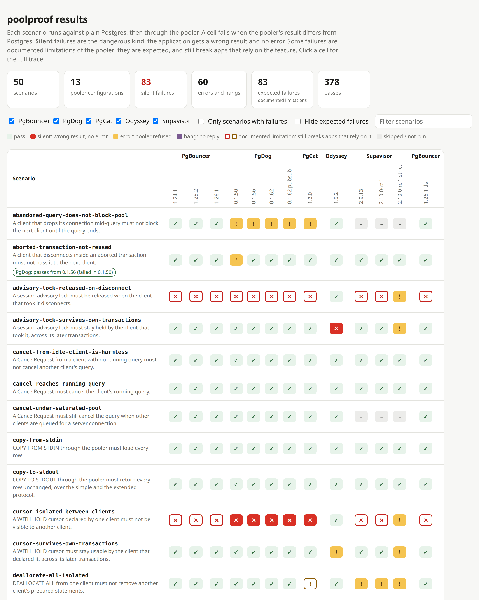

# poolproof

Find out what breaks when you put a connection pooler in front of Postgres.

[](https://github.com/Nihal-Pandey-2302/poolproof/actions/workflows/ci.yml)
[](https://github.com/Nihal-Pandey-2302/poolproof/releases)
[](#license)

Poolers like PgBouncer, PgDog and Supavisor are supposed to be invisible to the
application. In transaction mode they mostly are, except when a `SET` leaks to another
client, a temp table shows up in someone else's session, or part of a query string never
runs. poolproof runs small scenarios against plain Postgres and then through your pooler,
and reports every step where the results differ. Postgres is the oracle, so no scenario
hardcodes the expected output.



## What it finds

From the committed results, on Postgres 17.11 and 18.4:

- **PgDog 0.1.50 to 0.1.62**: in `BEGIN; INSERT ...; COMMIT` sent as one query string, only
  the `BEGIN` runs. The client gets no error ([pgdog#1849](https://github.com/pgdogdev/pgdog/issues/1849)).
- **PgDog 0.1.56 and 0.1.62, PgCat 1.2, Odyssey 1.5**: after `SET LOCAL statement_timeout TO
  DEFAULT` in a committed transaction, the client's session value is gone. `SHOW` gives
  `0` where Postgres gives `5s`. PgDog 0.1.50 passes.
- **Supavisor 2.9.13 and 2.10.0-rc.1** (default settings): a client that prepares a
  statement name another client already used gets 42P05, and its next Bind returns the
  other client's result.
- **Supavisor 2.9.13**: four pipelined requests hang in 9 of 10 runs
  ([supavisor#1239](https://github.com/supabase/supavisor/issues/1239)). 2.10.0-rc.1 answers them.
- **PgBouncer 1.26.1 on Postgres 18**: a client that set an empty `search_path` with
  `set_config()` loses its connection at its next query, once another client has changed
  `search_path` ([pgbouncer#1663](https://github.com/pgbouncer/pgbouncer/issues/1663)).
- **Every pooler but Odyssey**, with default settings, keeps a session advisory lock after
  the client that took it disconnects. PgBouncer, PgDog, PgCat and Supavisor document this
  one.

## Results

50 scenarios on Postgres 18.4, newest tested version of each pooler, default settings.
"Documented" FAILs are limitations the pooler's own docs describe; they still break an
app that relies on the feature.

| Pooler | Versions tested | Pass | FAIL, documented | FAIL, not documented | Skip |
|---|---|---:|---:|---:|---:|
| PgBouncer | 1.24.1, 1.25.2, 1.26.1 | 33 | 11 | 2 | 4 |
| PgDog | 0.1.50, 0.1.56, 0.1.62 | 28 | 1 | 17 | 4 |
| Supavisor | 2.9.13, 2.10.0-rc.1 | 28 | 12 | 8 | 2 |
| PgCat | 1.2.0 | 27 | 9 | 10 | 4 |
| Odyssey | 1.5.2 | 35 | 0 | 11 | 4 |

Every cell with its step-by-step trace is on the
**[results site](https://nihal-pandey-2302.github.io/poolproof/)**, and as a table in
[RESULTS.md](RESULTS.md). [docs/results.md](docs/results.md) explains the verdicts.

## Install

Binaries for Linux and macOS (x86_64 and arm64) and Windows (x86_64) are on the
[releases page](https://github.com/Nihal-Pandey-2302/poolproof/releases), with SHA256SUMS
and a build attestation (`gh attestation verify FILE --repo Nihal-Pandey-2302/poolproof`).
To build it yourself (it isn't on crates.io yet):

```sh
cargo install --locked --git https://github.com/Nihal-Pandey-2302/poolproof --tag v0.1.0 poolproof
```

Building needs Rust 1.88 or newer, a C compiler and libclang:
[docs/install.md](docs/install.md) has the details, shell completions and man pages.

## Quick start

Point poolproof at your pooler and the Postgres server behind it. Use a scratch
database: scenarios create and drop their own `pp_` objects, and `--reset all` ends every
other session on it before each scenario.

```text
$ export PGPASSWORD=...
$ poolproof run --pooler postgres://app@pooler-host:6432/app \
                --direct postgres://app@postgres-host:5432/app \
                --reset all --product pgbouncer --version 1.26.1
PASS  pgbouncer-1.26.1         abandoned-query-does-not-block-pool
FAIL  pgbouncer-1.26.1         empty-search-path-from-set-config (error)
      An empty search_path set with set_config() must survive another client changing it.
      step 7: [a] simple: SHOW search_path
      postgres: ok rows=[()] tags=[0]
      pooler:   error CLOSED: connection closed
      from https://github.com/pgbouncer/pgbouncer/issues/1663
FAIL  pgbouncer-1.26.1         set-isolated-between-clients (silent, documented)
      A plain SET from one client must not change the setting another client sees.
      step 7: [a] simple: SHOW work_mem
      postgres: ok rows=[(7MB)] tags=[0]
      pooler:   ok rows=[(9MB)] tags=[0]
      documented: "SET/RESET | Yes | Never" https://github.com/pgbouncer/pgbouncer.github.io/...
...
33 passed, 13 failed (11 documented), 0 errors, 4 skipped
```

Abridged. `--reset all` against a Postgres on another machine also needs `--yes`;
[docs/targets.md](docs/targets.md) covers the other resets, TLS, targets files for several
poolers, and `poolproof doctor`, which checks a setup before you run anything.

Save a run and turn it into one self-contained page to share:

```sh
poolproof run ... --format json > run.json
poolproof report run.json --format html > report.html
```

## Scan your queries

`scan` reads a `pg_stat_statements` export, Postgres logs or a `.sql` file and flags what
breaks under transaction pooling, using the Postgres parser. With `--pooler`, each finding
is checked against what that pooler did in poolproof's own runs:

```text
$ psql -c "\copy (SELECT query, calls FROM pg_stat_statements) TO 'queries.csv' CSV HEADER"
$ poolproof scan queries.csv --pooler pgbouncer
BREAKS   session-advisory-lock       calls=48211    SELECT pg_advisory_lock($1)
         on pgbouncer-1.26.1: advisory-lock-released-on-disconnect fails silently, ...
BREAKS   temp-table                  calls=12       CREATE TEMP TABLE import_rows (id int)
         on pgbouncer-1.26.1: temp-table-isolated-between-clients fails silently, ...
OK       session-set                 calls=1022     SET search_path TO app
         on pgbouncer-1.26.1: search-path-isolated-between-clients passes
...
6 queries scanned, 4 findings. On pgbouncer-1.26.1 (Postgres 18.4): 3 break silently, 0 rejected, 1 handled.
```

Abridged. More inputs, the rules and SARIF output: [docs/scan.md](docs/scan.md).

## Use it in CI

The repository is also a GitHub Action. It downloads the release binary, checks it
against SHA256SUMS and its build attestation, and runs `scan` or `run`:

```yaml
- uses: Nihal-Pandey-2302/poolproof@v0.1.0
  with:
    command: scan
    args: migrations/all.sql
    sarif: true   # findings also show up in code scanning (needs security-events: write)
```

`run` in CI, the inputs and the outputs: [docs/github-action.md](docs/github-action.md).

## Docs

- [Install](docs/install.md): release binaries, building from source, completions and man pages
- [Results and verdicts](docs/results.md): failure kinds, `--fail-on`, `--compare-to`, report formats
- [Documented limitations](docs/limitations.md): FAILs the pooler's own docs describe
- [Testing your pooler](docs/targets.md): URLs, TLS, targets files, probes, reset, `doctor`
- [Managed poolers](docs/managed-poolers.md): RDS Proxy, hosted Supavisor
- [Scanning your queries](docs/scan.md)
- [Real drivers](docs/drivers.md): psycopg, pgx, node-postgres and pgjdbc through each pooler
- [GitHub Action](docs/github-action.md)
- [Writing a scenario](docs/scenarios.md), and [CONTRIBUTING.md](CONTRIBUTING.md)
- [The test bed](docs/test-bed.md): every pooler version locally, PgDog from source
- For contributors: [a code tour](docs/code-tour.md) and [the architecture](docs/architecture.md)

The best scenarios come from real bug reports. If your pooler bit you, a scenario with a
link to the issue is the most useful contribution.

## Status

Not covered yet:

- RDS Proxy and hosted poolers are not in the test bed; they can be tested with the
  recipes in [docs/managed-poolers.md](docs/managed-poolers.md).
- The variant targets (`targets-variants.toml`: session mode, pool_size 4 and five
  non-default pooler settings) run nightly on Postgres 18.4 only; their results are
  published on the site under their own heading.
- `scripts/pgdog-ref.sh` has not been checked with release builds, its default.

## License

MIT OR Apache-2.0
